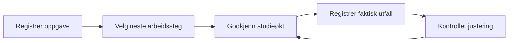
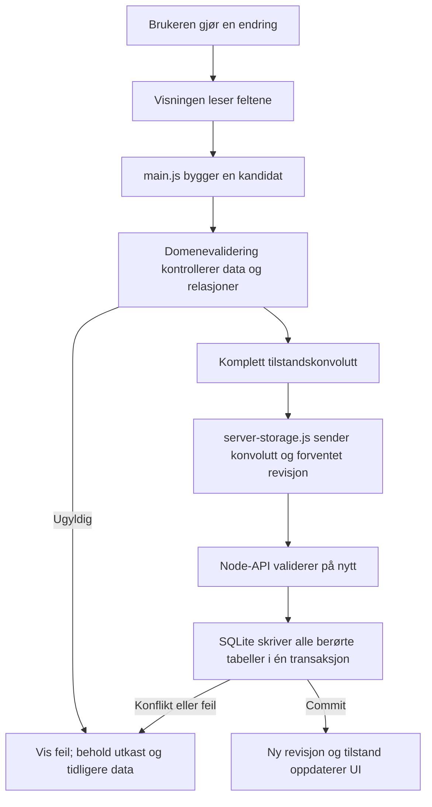

# Slik virker Ajour

**[Åpne Ajour på nett](https://ajour-sooty.vercel.app/) — Ingen installasjon nødvendig.** Begynn med en oppgave, kontroller en studieøkt og registrer utfallet etter arbeidet. [Brukerveiledningen](../../studieplanlegger/README.md#kom-i-gang-og-finn-frem) viser de første stegene; [lokal drift og utvikling](../../studieplanlegger/README.md#lokal-drift-og-utvikling) er alternativer for sensor og utviklere.

Planen i nettutgaven tilhører nettleserprofilen og den nøyaktige nettadressen. Sletting av nettleserdata kan slette planen; det finnes ingen konto eller enhetssynkronisering. Bruk **Innstillinger → Data og sikkerhetskopi** for å oppbevare en separat kopi eller flytte data. Lokal Node-/Docker-drift bruker SQLite; tabellen nedenfor skiller driftsformene.

**Oppgave eller steg:** Kalenderens planforslag reserverer tid til oppgaven. Neste-handling-knappen **Start** kan vise et bestemt startklart arbeidssteg; dette målet følger med til utfallsdialogen og arbeidsloggen med stabil identitet. Navneendring eller omrekkefølge endrer ikke tidligere arbeid. Gjenstående arbeid i utfallet gjelder hele oppgaven, uavhengig av faktisk tid. Eldre logger uten kjent stegkobling beholdes uten gjetting. [Datert avklaring og tekniske kontroller](work-step-identity-2026-11-02.md) forklarer forskjellen mellom den opprinnelige oppgaveprøven og den faktiske stegflyten.

## Hovedflyt og gjeldende løfte

[Brief, PRD og stories](../planning-artifacts/README.md) ble rekonstruert **2026-10-16** for å gjøre kodegrunnlaget etterprøvbart. Importløftet er avgrenset til de navngitte HiMolde-/NTNU-prøvene i briefen; nasjonal dekning er framtidsvisjon. Historiske kontroller nedenfor er ikke nye kjøringer eller studentresultater.

Et enkelt **syntetisk** eksempel: Opprett emnet «Eksempelfag» og oppgaven «Les eksempelkapittel». Bare tittelen er nødvendig; legg eventuelt til steget «Les første avsnitt». Legg til et ledig arbeidsvindu og en opptatt periode. Kontroller en foreslått halvtimesøkt før godkjenning. Etter økten registreres 30 faktiske minutter og for eksempel 45 minutter gjenstående hver for seg. Hvis planen må endres, kontrolleres og godkjennes et forslag som kan angres. Et ferdig steg fullfører ikke hele oppgaven, og ferdig arbeid bekrefter ikke innlevering. Eksemplet beskriver **oppgave → arbeidssteg → godkjent studieøkt → utfall → justering**, ikke en ny utført prøve eller en students erfaring.

Tekniske beslutninger og sammenhengen med krav står i [arkitekturen](../planning-artifacts/architecture/architecture-studieplanlegger-2026-09-06/ARCHITECTURE-SPINE.md). Etter prosjekteierens beslutning **2026-10-26** gjelder [egenutprøvingen](../planning-artifacts/USER-TRIAL-PLAN.md) prosjekteieren alene, med syntetiske data i et isolert miljø. [Prøverapporten 4. november](owner-trial-2026-11-04.md) dokumenterer beståtte sju scenarier og navngitt Start-tillegg, med rettet prøveutførelse og metodegrenser. Resultatene dokumenterer egne observasjoner, ikke ukjente brukeres forståelse eller generell studentnytte. Dokumentasjonsarbeidet bruker Codex; den manuelle egenutprøvingen er utført av prosjekteieren. Lesing av hele sensorveiledningen for del 1 er sist dokumentert i leveringskontrollen 1. november.

Ajour er en studieplanlegger for nettleseren, med valgfri lokal Node-/Docker-drift, skrevet med vanlig JavaScript, HTML og CSS. Reglene er faste og forklarbare; appen bruker ingen KI-tjeneste under kjøring. KI har bidratt i utviklingsarbeidet, som er dokumentert i [utviklingsprosessen](development-process.md). Dokumentet er ikke studentens personlige refleksjonsrapport.

## Nettleserutgave — 2026-10-29

[Ajour på nett](https://ajour-sooty.vercel.app/) bruker den samme hovedflyten med planen i nettleserprofilens `localStorage` og avgrensede Vercel-funksjoner for offentlig import. Profiler og nøyaktige nettadresser har separate data; localhost, forhåndsvisning og publisert adresse deler ikke automatisk plan. Sikkerhetskopi brukes til flytting og oppbevaring. Ingen konto, skydatabase eller enhetssynkronisering er innført. [Publiseringskontrollen fra 29. oktober](../../.logs/997-2026-10-29-13-35-00-ajour-vercel.md) er teknisk historikk; gjeldende egenutprøving står i [prøverapporten 4. november](owner-trial-2026-11-04.md). De lokale alternativene i tabellen beholdes.

## Nettutgave og lokale kjøremåter

| Kjøremåte | Autoritativ lagring | Bruksområde |
| --- | --- | --- |
| [Publisert nettutgave](https://ajour-sooty.vercel.app/) | Nettleserprofilens `localStorage`, separat for hver nettadresse | Vanlig bruk uten installasjon. Vercel leverer appen og avgrensede importfunksjoner; ingen delt studentlagring, konto eller skydatabase. |
| Lokal Node-server eller Docker | Node-API og SQLite | Lokal drift. Node serverer den bygde Vite-klienten, validerer alle endringer og skriver databasen transaksjonelt. Node bruker den valgte databasefilen; Compose publiserer bare på `127.0.0.1` og beholder databasen i et navngitt volum. |
| Vite-utvikling og lokal Vite-forhåndsvisning | Nettleserprofilens `localStorage`, separat for hver nettadresse | Lokal utvikling og nettleserkontroll. Denne modusen bruker ikke SQLite og dokumenterer derfor ikke lokal serverlagring. |

Ved første start av lokal Node-/Docker-drift kan en tom SQLite-database tilby å kopiere gyldige eksisterende nettleserdata fra samme adresse. Originalen i nettleseren beholdes. Flyttingen bruker fingeravtrykk og arkivkvittering, slik at samme datasett ikke importeres flere ganger. Eksport og validert gjenoppretting brukes til å flytte data mellom adresser og driftsformer.

## Fra brukerhandling til SQLite i lokal Node-/Docker-drift

Diagrammet gjelder den lokale serverutgaven. Nettutgaven og Vite bruker nettleserlagring og sender ikke planen til dette API-et.

En ny oppgave trenger bare et navn. Emne, frist, hovedestimat, gjenstående arbeid, prioritet, avhengigheter og innleveringskrav kan legges til når de er kjent. [tasks.js](../../studieplanlegger/src/tasks.js) normaliserer og validerer oppgaven. [storage.js](../../studieplanlegger/src/storage.js) velger lagringsadapter: Vite-/Vercel-modusen validerer den komplette konvolutten før `localStorage`, mens lokal Node-/SQLite-modus sender kandidaten og forventet revisjon til [state-api.js](../../studieplanlegger/server/state-api.js). API-et validerer hele datasettet og relasjonene før [database.js](../../studieplanlegger/server/database.js) skriver SQLite.

Et valgfritt øktforslag ved oppgaven gjør det enklere å komme i gang. [study-time.js](../../studieplanlegger/src/study-time.js) skiller bekreftede arbeidsvinduer, valgte studietidspreferanser, konkrete engangsforslag og foreløpige antakelser. Et lagret mønster gjenbrukes, mens «Det varierer» og et utkast uten valg ikke oppretter et ukemønster. [replanning-view.js](../../studieplanlegger/src/replanning-view.js) viser lesbare økter og manuelle dato-/tidsfelt først ved siste flyttealternativ. [replanning.js](../../studieplanlegger/src/replanning.js) håndhever reglene, avgrenser endringene til den aktuelle oppgaven, validerer flyttealternativer og avviser foreldede utkast før lagring.

I lokal Node-/SQLite-modus sender klienten revisjonen den sist leste. Hvis en annen endring allerede har økt revisjonen, svarer API-et med HTTP 409 i stedet for å overskrive nyere data. Den avviste kandidaten blir ikke delvis lagret; klienten må lese gjeldende tilstand og la brukeren prøve endringen på nytt. Vite-/Vercel-modus har ikke serverrevisjoner; nettleserens optimistiske konfliktvern erstatter ikke SQLite-transaksjoner. Bruk én redigerende fane i nettutgaven og oppbevar egne sikkerhetskopier.

## Programimport i én sammenhengende flyt

En lokal, regelbasert tekstregistrering gir et kompakt, redigerbart forslag for oppretting av oppgave eller egen aktivitet samt endring av frist eller gjenstående arbeid. En trygg, deklarativ tekst uten kommandoprefiks blir en oppgavetittel; spørsmål og uklare endre-, flytte- eller sletteønsker blir aldri automatisk opprettet. Tittel er eneste obligatoriske oppgavefelt, mens tomt/«uten emne» og «vet ikke»/«mye» beholder henholdsvis manglende emnekobling og ukjent arbeid. Parseren har injisert referansetid, gjør korte og relative norske datoord om til konkrete Oslo-datoer, beholder frister uten klokkeslett som dato og skriver ingenting. Egne aktiviteter lagres uten falskt emne eller importkilde, og bare et kjent start-/sluttintervall reserverer kapasitet. Oppgavemål treffes eksakt eller krever valg. Ved bekreftelse kontrollerer `main.js` identitet og gammel verdi på nytt og bruker samme validering, historikk og revisjonsbeskyttede lagringsbane som skjemaene. Råteksten blir ikke del av domenet eller historikken.

Importerte kalenderhendelser kan bære `activityKind: "exam"` fra et strukturert ICS-felt gjennom kildegrunnlag, oppdatering, lagring og sikkerhetskopi. `activityKind: "assessment"` beholdes som separat, generell kildesemantikk og blir ikke normalisert til eksamen. Eldre hendelser klassifiseres for visning bare med et smalt tittelkriterium for eksamen/exam/examination og eksplisitte unntak for forberedelse, prøve-/mockeksamen og forelesninger om eksamen. Alle visninger henter samme presentasjonsmetadata (`📝 Eksamen` og egen aksent), mens domenets eksisterende `kind` fortsatt er undervisning eller informasjon slik at filtre og kapasitet beholder betydningen sin.

[vortex-programs.js](../../studieplanlegger/server/providers/vortex-programs.js) beholder publiserte krav og alternativgrener i stedet for å gjøre alle emner obligatoriske. HiMolde IT 2026–27 er regresjonseksempelet: IBE110 og IBE430 er påkrevde, mens studenten må velge enten IBE160 eller hele kombinasjonen IBE102 + IBE152. Studiepoeng vises, men avgjør ikke om et valg er gyldig.

[program-import-view.js](../../studieplanlegger/src/program-import-view.js) beholder program, kull og periode mens studenten korrigerer alternativet eller legger til et manglende emne. Et separat emnesøk er ikke programbevis, og en manuell post merkes uverifisert. Undervisning hentes og vises per emne; feil eller tilgangskrav blokkerer ikke gyldige emner eller vellykket undervisning. Før lagring kontrolleres fortsatt utvalgsøyeblikket og hele tilstandsgrunnlaget. Én commit skriver resultatet, og kvitteringen skiller emner med importert undervisning fra emner uten.

## Undervisningsvalg, oppdatering og kalenderidentitet

Programflyten og den separate emneflyten bruker samme undervisningskontrakt. Hvert emne beholder siste kontrollforsøk og siste vellykkede kontroll separat. Tom kilde, timeout, transportfeil, ugyldig kildesvar, tilgangskrav og manglende støtte gir forskjellige statuser; ingen av dem sletter tidligere lagret undervisning. Aktivitetstyper, valgte grupper, individuelle utelatelser og nye uavklarte grupper lagres med kildeobjekt og periode, slik at omlasting, nytt forsøk, SQLite-restart og sikkerhetskopi ikke endrer studentens valg.

En innholdsmessig og semantisk uendret oppdatering av en undervisningskilde lagrer bare ny kontrolltid og avslutter med «Timeplanen er kontrollert – ingen endringer.» uten en ekstra bekreftelse. Identisk dokument-/filreimport beholder derimot også importtidspunktet og lager ingen ny stor angrekopi; disse er forskjellige flyter. Endret kildeidentitet, dekning, varsler, aktivitetsvalg eller uavklarte grupper åpner fortsatt kontroll. Delvise DOM-oppdateringer gjenoppretter åpne detaljer, relevant fokus og intern rulleposisjon; sene svar fra et tidligere valg ignoreres.

[calendar-model.js](../../studieplanlegger/src/calendar-model.js) fører full emnekode videre til undervisning, frister og studieøkter. Alle kalendervisninger bruker samme deterministiske emnefarge, men viser også kode og tekstlig aktivitetstype eller status, slik at farge aldri er eneste identifikasjon.

## Tre forskjellige planleggingsfunksjoner

**Oppgaveforslag («Ditt neste steg»)** velger en startklar handling ut fra «Hvor lenge vil du jobbe nå?». [tasks.js](../../studieplanlegger/src/tasks.js) bruker blant annet første startklare arbeidssteg eller gjenstående arbeid, frist, prioritet og avhengigheter. «Totalt gjenstående arbeid» beskriver hele arbeidsmengden; «Kan deles i flere økter» tillater en kort deløkt også uten arbeidssteg. Ett forslag vises som hovedvalg; resten er alternativer. Et forslag endrer ikke totalanslaget og registrerer verken tid eller ferdig arbeid. Reelle blokkeringer og ikke-delbart arbeid begrenser fortsatt valget. Forutsetninger er eksisterende oppgaver som må gjøres først, og kan fjernes samlet i oppgaveutkastet før lagring. Sletting av et arbeidssteg sletter ikke oppgaven eller markerer den automatisk ferdig.

**Kapasitetsberegning** vurderer om registrert gjenstående arbeid får plass i bekreftede arbeidsvinduer og eksisterende studieøkter. [work-capacity.js](../../studieplanlegger/src/work-capacity.js) tar hensyn til undervisning/opptatt tid, frister, avhengigheter, låste reservasjoner, delbarhet og økt-/pauseregler. Resultatet forklarer reservert, foreslått, manglende og ledig tid. Beregningen endrer ikke planen.

**Omplanlegging** lager et konkret forslag til framtidige studieøkter når planen ikke lenger passer. [replanning.js](../../studieplanlegger/src/replanning.js) bruker samme arbeidsvinduer, opptatt tid, frister, avhengigheter og regler, men produserer økter som brukeren kan kontrollere, redigere, godta eller forkaste. Forslaget har et fingeravtrykk av utgangspunktet og kan ikke godtas hvis dataene har endret seg i mellomtiden.

Ingen av funksjonene hevder at arbeid er utført. De bruker registrerte opplysninger og kan bare bli så presise som frister, estimater, arbeidsvinduer og avhengigheter tillater.

## Planlagt tid, faktisk arbeid, ferdig og levert

| Opplysning | Betydning |
| --- | --- |
| Planlagt eller foreslått tid | En framtidig reservasjon eller beregnet mulighet. Den er ikke gjennomføringshistorikk. |
| Faktisk arbeid | Minutter og utfall studenten registrerer etter arbeid. Arbeidsloggen kan brukes i frivillige, lokale estimatforslag. |
| Gjenstående arbeid | Studentens nåværende anslag for det som fortsatt må gjøres. Det reduseres ikke bare fordi en økt er passert. |
| Ferdig / fullført | Studenten har bekreftet at selve arbeidet er ferdig. Hvis oppgaven skal leveres, er den da «klar til levering». |
| Levert | Studenten har separat bekreftet innlevering. Ajour kontrollerer ikke lærestedets innleveringssystem. |

«Neste steg gjort» markerer det aktive steget fullført og beholder identitet og historikk. Handlingen registrerer ikke automatisk minutter og fullfører ikke hele oppgaven. Null gjenstående arbeid betyr heller ikke automatisk ferdig. Disse skillene gjør at kalenderen, arbeidsloggen og innleveringsstatusen ikke brukes som bevis for hverandre.

## Arbeidssteg, egenvurdering, kalenderkopi og plansammenligning

[work-steps.js](../../studieplanlegger/src/work-steps.js) gjør et eldre `nextStep` om til et stabilt, ordnet steg først når oppgaven faktisk endres. Stegene kan ha valgfrie estimater og avhengigheter, men [tasks.js](../../studieplanlegger/src/tasks.js) og planleggingsmodulene bruker fortsatt oppgavens gjenstående intervall som eneste totalsum. Dokumentforslag i [work-step-proposals.js](../../studieplanlegger/src/work-step-proposals.js) merker hver rad som kildekrav, arbeidsmåte eller uavklart og krever samlet godkjenning.

Rettelsen 2. oktober 2026 normaliserer også blandingen av `nextStep` og `steps` ved lesing, uten å skrive ved åpning. Eksisterende rekkefølge og ID-er beholdes; et separat eldre steg legges til med et deterministisk ledig ID-suffiks. Bare eksplisitt eldre opphav og identisk opprinnelig tekst, minutter og venteflagg kan representere samme steg; eksisterende fullføring og senere notater/forutsetninger blir bevart. Begge fjernhandlinger bruker samme sperre: avhengige steg navngis, og studenten må redigere forutsetningene før sletting. Ingen koblinger fjernes automatisk.

Eldre tekst og avledede ID-er som var gyldige uten lengdegrense, beholdes tapsfritt ved normalisering, fullføring, SQLite-lagring og backup. Vanlige stegfelt beholder sine grenser. Tastaturfokus etter vellykket sletting går til et gjenværende steg eller legg-til-knappen; avvist lagring beholder hele utkastet for et atomisk nytt forsøk.

[review-planning.js](../../studieplanlegger/src/review-planning.js) lagrer valgfrie, daterte egenvurderinger knyttet til tema og eventuell avsluttet økt. Bare vurdering 1 eller 2 utløser et forklart forslag. Forslaget bruker registrerte arbeidsvinduer, opptatt tid og kalenderaktiviteter, lager ingen dato når eksamensdatoen er ukjent og blir ikke en vanlig studieøkt før studenten godkjenner eller justerer det. Utsettelse og avvisning hindrer duplikatforslag uten å endre vurderingen.

**Koblingsregelen:** vurderingen gjelder temaet. Oppgave og emne er valgfrie temakoblinger, mens en levende eller loggført økt er uavhengig valgfri kontekst; samme oppgave kreves ikke for historiske vurderinger. Nye ukjente referanser avvises. Automatisk avslutning bruker den faktisk validerte økten fra arbeidsloggen, aldri en annen nylig økt. Visningen bruker faktisk lagret historisk oppgave-/øktinformasjon og angir ukjent kontekst når den mangler. Gjenbrukt tema viser lagret eksamensdato; utelatt felt bevarer datoen, mens eksplisitt tomt felt fjerner den. Endringen følger eksisterende regler for framtidige repetisjonsvalg og omskriver ikke tidligere vurderinger eller ferdig repetisjon.

En repetisjonsøkt som allerede brukes som kontekst av en vurdering beholdes sammen med beslutningen ved endrede temainnstillinger. Ved uttrykkelig endring/sletting av vurderingen som eier beslutningen fjernes beslutningen; en økt som andre vurderinger fortsatt peker til beholder identitet, oppgave, tema og tidspunkt, mens bare foreldet `reviewKey` tas bort. Historiske vurderinger og arbeidsloggens øyeblikksbilder skrives aldri om for å reparere koblingen.

Forhåndsvisning og lagring bruker samme forberedelse av tema og framtidige planer. Endret grunnlag nullstiller tidligere godkjenning og foreldede automatiske tidsfelt; eksplisitt redigerte manuelle tider beholdes for et nytt valg. Historiske navn hentes bare fra samsvarende øyeblikksbilde, aldri fra dagens omdøpte oppgave. Den avgrensede reviewrettelsen gjør også at `purgeAssessments` fjerner frakoblede repetisjonsøkter med bare `reviewTopicId`, i samsvar med den eksisterende slettingen av arbeidshistorikk.

[calendar-export.js](../../studieplanlegger/src/calendar-export.js) eksporterer bare valgte, lagrede typer i synlig periode. Handlingen «Eksporter kalender» ligger øverst i kalendervisningen og viser antallet før nedlasting; en tom kombinasjon gir ingen fil, og en tvetydig frist forklares som utelatt til studenten presiserer tiden. Frister er transparente `VEVENT`-komponenter uten oppdiktet sluttid, der dato uten klokkeslett bruker `DTSTART;VALUE=DATE`, og studie-/undervisningsøkter er `VEVENT` i UTC beregnet fra norsk lokal tid. Filen bruker CRLF, UTF-8-sikker linjefolding, tekstescaping og stabile ugjennomsiktige 128-bits UID-er. Formatet er kontrollert mot RFC 5545 og leses tilbake med prosjektets låste `ical.js`; eksporten er en kopi og gir ingen synkronisering eller garanti mot duplikater i mottakerprogrammet. Microsoft dokumenterer at Outlook for Windows ignorerer `VTODO`, derfor brukes bare én `VEVENT`-representasjon per frist. Prosjekteierens faktiske Outlook-prøve med 37 hendelser 30. oktober er dokumentert bestått i [prøveplanen](../planning-artifacts/USER-TRIAL-PLAN.md); det er ikke en godkjenning av alle Outlook-klienter eller gjentatt import.

Utelatelseslisten navngir frist, lagret datoverdi og konkret årsak uten å gjette et annet tidspunkt. Repetisjon uten oppgave bruker temaets faktiske tittel, eller et uttrykkelig manglende-tema-navn. Programvelgeren bruker norsk `nb-NO`-rekkefølge med stabile sekundærnøkler; gjenoppretting viser samme variantetikett med kode, nivå, kull og inntak. Kildens grupper, modeller og perioder beholder sin egen rekkefølge og identitet. De nye syntetiske nettleser- og produksjonsforløpene finnes i testfilene med `bounded` i navnet; [verifikasjonsoversikten](../../studieplanlegger/VERIFICATION.md#omfang-og-hvordan-resultatene-skal-leses) forklarer begrensningene ved daterte tekniske kontroller.

[plan-comparison.js](../../studieplanlegger/src/plan-comparison.js) beregner alle alternativer fra samme fingeravtrykk, klokkeslett og periode. «Behold dagens plan» er et nullalternativ; redusert kapasitet og valgt oppgaveprioritet går gjennom den eksisterende omplanleggeren. Sammenligning skriver ingenting. Bruk av ett forslag går gjennom samme revisjonskontroll og historikk som andre samlede planendringer, slik at et foreldet forslag avvises og en anvendt plan kan angres.

I lokal Node-/Docker-drift har SQLite-tabellene `topics`, `assessments` og `review_decisions` relasjonelle identitetskolonner og tapsfri JSON. Nettleserlagring, sikkerhetskopi, recovery og historikk bruker de samme valgfrie feltene i tilstandskonvolutten. Personvernsletting fjerner arbeidshistorikk, egenvurderinger, beslutninger og tilhørende repetisjonsøkter også fra lokale recovery-kopier og lesbare legacy-arkiver; den endrer ikke sikkerhetskopier brukeren allerede har lastet ned.

## Feil, sikkerhetskopi og gjenoppretting

Ugyldige felt eller relasjoner avvises før skriving i begge driftsformer. I lokal Node-/Docker-drift kjøres en SQLite-endring som består av flere tabelloperasjoner i én transaksjon; enten lagres hele tilstanden med ny revisjon, eller så beholdes den forrige. Nettutgaven validerer tilstanden før nettleserlagring, med egne kvote- og konfliktgrenser. Erstattende endringer lager et begrenset recovery-øyeblikksbilde.

Under **Innstillinger → Data og sikkerhetskopi** kan brukeren eksportere en portabel JSON-fil og forhåndsvise validert gjenoppretting før dataene erstattes. Tilgangsopplysninger utelates fra filen; kalenderlenker kan kreve ny tilkobling. Recovery, angre og papirkurv er hjelp mot nylige brukerhandlinger og erstatter ikke en separat kopi ved sletting av nettleserdata eller diskfeil. Kalenderens `.ics`-eksport er heller ikke en full sikkerhetskopi.

## Hva testene kontrollerer

- [Enhetstestene](../../studieplanlegger/tests/unit) dekker validering, relasjoner, forslag, kapasitet, omplanlegging, arbeidsstatus, SQLite-migrering, revisjonskonflikter, recovery og sikkerhetskopi.
- [Nettlesertestene](../../studieplanlegger/tests/e2e) kontrollerer de synlige brukerflytene. `npm.cmd run test:e2e` bruker Vite/localStorage; `npm.cmd run test:e2e:ci` bruker den bygde klienten med nettleserlagring på en midlertidig loopback-adresse.
- `npm.cmd run test:e2e:database` bygger klienten, starter lokal Node/SQLite med en midlertidig database på loopback og kjører databaseflyten. Dette er separat fra kontroll av publisert Vercel-versjon.
- [VERIFICATION.md](../../studieplanlegger/VERIFICATION.md) skiller daterte, faktisk kjørte kontroller fra historiske eller utestede påstander.

Testene bruker syntetiske data. Et grønt bygg viser at den kontrollerte tekniske flyten virker; det dokumenterer ikke studentens opplevde nytte eller læring. [Utviklingsprosessen](development-process.md) beskriver dette skillet og samler kildebelagte hendelser uten å fylle inn personlige vurderinger.

## Fleksibel registrering og egne aktiviteter

Tekstregistreringen godtar en trygg deklarativ tittel uten kommandoprefiks og viser først et kompakt forslag; emne, frist og arbeid ligger under valgfrie detaljer. Spørsmål og ukjent mutasjonsintensjon avvises. Korte datoer bruker inneværende Oslo-år når datoen ikke er passert; ellers kreves eksplisitt årsvalg. Ukjent arbeid er `null`, og tomt eller eksplisitt fravær av emne oppretter aldri et kunstig emne.

Egne kalenderaktiviteter ligger i `planner.events` med `activityKind: "personal"`, tom `courseId`, `dateLocal` og valgfri `start`/`end`. Bare begge instanser blokkerer kapasitet. Dato alene og start alene vises med eksplisitt usikkerhet på kalender-, agenda- og dagsflater. Kildeoppdatering er isolert gjennom fravær av kildeidentitet, og ICS-eksport krever et eget opt-in-valg og bevarer den lagrede presisjonen.

## Datert leveringsstatus og utviklingshistorikk

**Leveringsstatus 4. november 2026:** Prosjekteieren har bestått alle sju scenarier og navngitt Start-tillegg 3.–4. november, inkludert gjenoppretting i et separat, tomt Chrome Gjest-miljø. [Prøverapporten](owner-trial-2026-11-04.md) lukker det tidligere SC-07/R-07-dekningsforbeholdet innen dokumentert omfang og oppgir rettet prøveutførelse og metodegrenser. Tidligere daterte omprøvinger, SC-07/1200–30 og Outlook-prøven beholder sine resultater. [Begrensningsoversikten](../../studieplanlegger/README.md#kjente-begrensninger-ved-levering) og [leveringsoversikten](../../README.md#leveringsoversikt--4-november-2026) viser gjeldende status. [Refleksjonsrapporten](../submission/reflection-report.md) foreligger bare som Markdown; personlig sluttgjennomlesing og innlevering er ikke bekreftet.

[Planindeksens leveringskontroll](../planning-artifacts/README.md#leveringskontroll--2026-11-04) bevarer vurderingsgrunnlaget og rapportens avgrensning. [Teknisk verifikasjon](../../studieplanlegger/VERIFICATION.md) samler daterte kontroller og publiseringsbevis. Historisk F03 og personvernoppfølging er ikke lukket av egenutprøvingen; den rettede fredags-/fristregresjonen 2. november lukker heller ikke historisk F03.

## Lokal oppfølging — 2026-10-26

Den fylte mobiloversikten har en kort introduksjon før Start. Tidsspørsmålet, hurtigvalgene og egendefinert tid er én samlet kontrollgruppe. Forfalt arbeid, ferdig arbeid og bekreftet innlevering beholder ulike handlinger, med rolige påminnelser etter hovedhandlingen. Tom onboarding tilbyr oppgave med bare tittel tydelig; import er valgfri. Dialoger skal ha synlige handlinger og faktisk intern rulling ved 200 % tekst, med alle felt tilgjengelige fra tastaturet og fokus tilbake ved lukking.

[Verifikasjonsoversikten](../../studieplanlegger/VERIFICATION.md#omfang-og-hvordan-resultatene-skal-leses) forklarer skillet mellom daterte kontroller og gjenbrukt teknisk evidens. Docker-blokkeringen i de tidligere rundene er historisk; temaoppfølgingen 26. oktober inkluderte senere beståtte isolerte Docker-prøver, og [sporbarheten](../planning-artifacts/TRACEABILITY.md#emnepalett-og-mørk-modus--2026-10-26) viser testgrunnlaget. Ingen ny runtimekontroll er utført i denne dokumentrevisjonen. Dette er teknisk evidens innen samme V1, ikke dokumentert studentnytte.

## Ajour-grensesnitt — 2026-10-25

Ajour beholder den samme hovedflyten og de samme dataene. **Kom ajour.** møter studenten med neste handling, og **Planer endrer seg. Det er helt greit.** forklarer plassen til omplanlegging. Korte oversiktsutdrag leder til fullstendige oppgave-, kalender- og planvisninger. Mobil prioriterer handlingen i én kolonne; kalenderen beholder egen avgrenset rulling. Tomme tilstander og ukjent tid skal forklares uten demoarbeid, oppdiktede anslag eller ubekreftede påstander om ledig kapasitet.

Ordmerke, notatbok/ansikt og dekor er lokale SVG-er gjenskapt fra de leverte desktop-/mobil-PNG-ene. En større designpakke var ikke tilgjengelig. Manrope og eksisterende fontlisens beholdes. [Arkitekturens AD-14](../planning-artifacts/architecture/architecture-studieplanlegger-2026-09-06/ARCHITECTURE-SPINE.md#ad-14--ajour-presentation-with-stable-data-contracts-2026-10-25) beskriver palett, teknisk navneklassifisering og bevarte kontrakter. [Ajour-sporbarheten](../planning-artifacts/TRACEABILITY.md#ajour-grensesnitt-og-bevaring--2026-10-25) kobler den nye utformingen og kompatibiliteten til kode og tester; tidligere kjøringer beviser ikke denne endringen.

**Samordning 2026-10-25:** [Importavtalen](../../studieplanlegger/IMPORT.md) beskriver felles forhåndsvisning, avklaring av emner/tid, gjentatt import og kildegrenser. [Nyeste verifikasjon](../../studieplanlegger/VERIFICATION.md) skiller kandidatkontrollene fra historiske resultater. Sensorveiledning og godkjent proposal manglet i publiseringsrunden før Ajour 25. oktober. Alle sju sensorsider ble senere lest i Ajour-runden samme dag; godkjent proposal er fortsatt ikke identifisert.

Kontrollen **1. oktober 2026** gjaldt de to lokale kjøremåtene: Node-/Docker-drift med SQLite og Vite med nettleserlagring. Nettutgaven ble godkjent senere, 29. oktober. Kontrollen dokumenterte at feilet kildeoppdatering bevarte tidligere undervisning og valg og registrerte nytt forsøk separat fra siste vellykkede kontroll. En enkelt HTTP-feil bekreftet ikke innloggingskrav. Kapasitetsberegningen reserverte også økter uten oppgave og varslet om egne aktiviteter med ukjent tid; plansammenligning talte ikke samme tidsintervall som arbeid for flere oppgaver. Gjentatt import av arbeidssteg bevarte allerede redigerte og fullførte steg. Se [gjeldende verifikasjon](../../studieplanlegger/VERIFICATION.md) og [datatypefordelt importdekning](../../studieplanlegger/IMPORT-COVERAGE.md).
